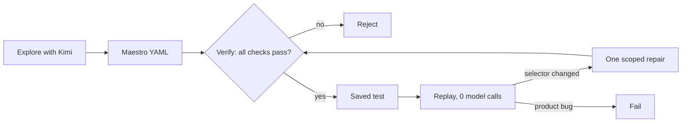

<h1 align="center">Déjà</h1>

<p align="center">
Explore an app once with an AI model. Replay the test later with no model at all.<br>
Déjà turns one verified run into a Maestro test that you own.<br>
The CLI command is still <code>walkcache</code>.
</p>

<p align="center">
  <a href="LICENSE"></a>
  <a href="https://github.com/seankim-android/deja/actions/workflows/portable-checks.yml"></a>
  
  
  
  
</p>

<p align="center"></p>

<p align="center">Narrated demo, 51 s.</p>

<p align="center">Watch the full demo: <a href="demo/deja-demo.mp4">demo/deja-demo.mp4</a></p>

## How it works

1. **Explore once.** Kimi K3.1 Pro on Cerebras drives the app through OpenClaw and Maestro. It writes a Maestro YAML test.
2. **Verify.** Déjà runs the YAML again on its own. It saves the test only if every check passes.
3. **Replay.** Later runs replay the saved YAML with zero model calls. A changed selector gets one small, scoped repair. A real product bug still fails.



## Results

All numbers come from the saved run reports in `demo/live-evidence/`.

| Run | Evidence file | Outcome | Model calls | Assertions | Duration |
| --- | --- | --- | --- | --- | --- |
| Android cold explore | `android/cold-run-report.json` | cold-recorded | 13 | 14 | 97.9 s |
| Android warm replay | `android/warm-run-report.json` | passed (cache hit) | 0 | 14 | 26.1 s |
| Android stale selector repair | `android/stale-repair-run-report.json` | repaired (1 repair) | 0 | 12 | 66.9 s (repair step) |
| Chromium warm replay | `chromium/run-run-report.json` | passed (cache hit) | 0 | 12 | 36.6 s |

Warm replay removes model calls. Maestro itself still takes time to run.

## Quick start

This Android path needs no model credentials. It assumes a running API 34 emulator, Bun 1.4 or newer, OpenJDK 21, `adb`, and Maestro 2.12.0 on `PATH`.

```sh
git clone https://github.com/seankim-android/deja.git
cd deja
bun install
cd spikes/001-android-walkcache
. ./scripts/env.sh

adb devices
./gradlew clean :app:assembleDebug
adb -s emulator-5554 install -r -g app/build/outputs/apk/debug/app-debug.apk
sh scripts/fixture-mode.sh stable

# Verify reviewed YAML, then save it.
bun ../../apps/cli/walkcache.ts remember checkout \
  --flow evidence/repaired-checkout.yaml --config walkcache.config.json

# Replay it. Expect: Cache status: hit, Model calls: 0.
bun ../../apps/cli/walkcache.ts run checkout --config walkcache.config.json
```

For cold exploration, set up OpenClaw with a Cerebras credential. Then run `explore checkout`. If you already have a `.walkcache` folder, move it aside first. More steps are in [docs/REFERENCE.md](docs/REFERENCE.md).

## CLI

| Command | What it does |
| --- | --- |
| `explore <goal>` | Explore on Android, verify the result, and save it if it passes. |
| `run <goal>` | Replay a saved test. Explore on a miss. Repair a stale selector once. |
| `remember <goal> --flow <file>` | Verify your own YAML and save it if it passes. |
| `list` | Show saved tests. No model is used. |
| `inspect <report>` | Print a saved, redacted run report. |

Options, config fields and exit codes are in [docs/REFERENCE.md](docs/REFERENCE.md).

## Tech stack

- Bun and TypeScript
- OpenClaw
- Kimi K3.1 Pro on Cerebras (`moonshotai-kimi-k3.1-pro-trial`)
- Maestro 2.12
- MCP SDK
- React viewer (read-only, optional)

## Limits

| Platform | What works | What does not |
| --- | --- | --- |
| Android emulator (API 34) | Cold exploration, replay, and one scoped selector repair. | Other repairs, real devices, other Android versions. |
| Web (Chromium, Maestro Web beta) | Replay of reviewed YAML. | Cold exploration and repair. |
| iOS (iPhone 17 simulator) | Replay of reviewed YAML. | Cold exploration and repair. |

We do not claim a speedup. See [docs/REFERENCE.md](docs/REFERENCE.md) for the full support matrix.

## License

[Apache-2.0](LICENSE)
