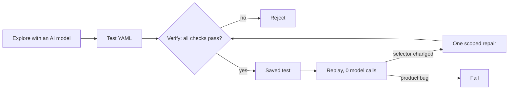

<h1 align="center"><picture><source media="(prefers-color-scheme: dark)" srcset="docs/brand/deja-logo-dark.svg"></picture></h1>

<p align="center">
Déjà is a memory layer for app tests. Learn a test once, then replay it with no model at all.
</p>

<p align="center">
  <a href="LICENSE"></a>
  <a href="https://github.com/seankim-android/deja/actions/workflows/portable-checks.yml"></a>
</p>

<p align="center">
  
  
  
</p>

<p align="center"></p>

<p align="center">All four steps, sped up 1.5x and silent. The full narrated demo is 55 s (link below). Built for the Cerebras x Kimi K3.1 Pro x OpenClaw hackathon (Nov 2026).</p>

<p align="center">Watch the full demo: <a href="demo/deja-demo.mp4">demo/deja-demo.mp4</a> · <a href="https://x.com/kssc0112/status/2124667198837059953">X post</a> · <a href="https://www.reddit.com/r/Cerebras/comments/1y34xuv/i_made_kimi_k31_pro_on_cerebras_test_my_app_once/">r/cerebras post</a> · <a href="https://discord.com/channels/1085960591052644463/1574227471706886236">Discord post</a></p>

## Why Déjà

- Replays make zero model calls and need no provider key.
- A test is saved only after it passes on its own run.
- A renamed selector gets one scoped repair, and a real product bug still fails.
- Tests are plain YAML files that your team owns and reviews in pull requests.
- A coding agent can replay your saved tests after each edit, with 0 model calls (`deja mcp`, beta).

## How it works

An AI model explores the app once and writes the test as YAML. You can also bring YAML you already have. Déjà runs the test again on its own and saves it only if every check passes. Later runs replay the saved test with no model. If a selector changed, Déjà tries one small, scoped repair. Remembering, replaying and repairing a test need no AI model.



## Quick start

Déjà is not on npm yet, so you run the CLI from a clone. These steps add Déjà to your own iOS app on a simulator. They need no AI model. You need a Mac with Xcode, Bun 1.4 or newer, and Java 17 or newer.

**1. Install the CLI and its test runner.** Déjà downloads its own pinned Maestro and never touches another Maestro on your machine.

```sh
git clone https://github.com/seankim-android/deja.git ~/deja
cd ~/deja && bun install
alias deja="bun ~/deja/apps/cli/deja.ts"

deja engine install
deja doctor
```

**2. Set up a simulator and build your app.** Use a simulator only Déjà uses, so other work doesn't move it. Build the app into a folder inside your repo, then install it.

```sh
UDID=$(xcrun simctl create deja com.apple.CoreSimulator.SimDeviceType.iPhone-17)
xcrun simctl boot "$UDID" && xcrun simctl bootstatus "$UDID" -b

xcodebuild -scheme MyApp -configuration Debug -sdk iphonesimulator \
  -derivedDataPath build CODE_SIGNING_ALLOWED=NO build
xcrun simctl install "$UDID" build/Build/Products/Debug-iphonesimulator/MyApp.app
echo "$UDID"
```

Déjà does not install the app for you. Install it again after each build.

**3. Add `deja.config.json` to your app's repo.** Put the simulator ID from step 2 in `device`.

```json
{
  "workspaceRoot": ".",
  "platform": "ios",
  "appId": "com.example.myapp",
  "buildPath": "build/Build/Products/Debug-iphonesimulator/MyApp.app",
  "device": "YOUR-SIMULATOR-UDID",
  "fixtureCredentials": [],
  "manifest": "deja.walks.json",
  "flowsDir": ".maestro/flows/deja",
  "verificationTimeoutMs": 180000,
  "maestro": { "timeoutMs": 180000 }
}
```

Add `.deja/` to your `.gitignore`. It holds local run history and reports.

**4. Write a test, or bring one you have.** Tests are plain Maestro YAML, for example `.maestro/flows/deja/checkout.yaml`:

```yaml
appId: com.example.myapp
---
- launchApp
- tapOn: "Checkout"
- assertVisible: "Order placed"
```

**5. Save it.** Déjà runs the test on its own and saves it only if every check passes. It also writes `deja.walks.json`. Commit that file with your tests.

```sh
deja remember checkout --flow .maestro/flows/deja/checkout.yaml
```

**6. Replay it.** Expect `Cache status: hit` and `Model calls: 0`.

```sh
deja run checkout
```

On a new build, `deja run checkout --verify` checks the test again. To let a coding agent replay your saved tests after each edit, run `deja mcp` ([MCP server](docs/REFERENCE.md#mcp-server)). Android and Chromium configs, and letting an AI model write tests for you (`explore`, Android only), are in [docs/REFERENCE.md](docs/REFERENCE.md#configuration).

<details>
<summary>Run the iOS demo app</summary>

The demo app lives in `spikes/003-ios-deja`. It needs step 1 first.

```sh
cd ~/deja/spikes/003-ios-deja
UDID=$(xcrun simctl create deja-demo com.apple.CoreSimulator.SimDeviceType.iPhone-17)
xcrun simctl boot "$UDID" && xcrun simctl bootstatus "$UDID" -b

xcodebuild -project DejaFixture.xcodeproj -scheme DejaFixture -configuration Debug \
  -sdk iphonesimulator -derivedDataPath build CODE_SIGNING_ALLOWED=NO build
xcrun simctl install "$UDID" build/Build/Products/Debug-iphonesimulator/DejaFixture.app
```

Put `$UDID` in the `device` field of `deja.config.json` in that folder. Then:

```sh
deja remember checkout --flow flows/checkout.yaml
deja run checkout
```

</details>

<details>
<summary>Run the hackathon demo (Android fixture)</summary>

The demo app lives in `spikes/001-android-deja`. It needs a running API 34 emulator, OpenJDK 21, `adb`, and the Maestro engine from step 1.

```sh
git clone https://github.com/seankim-android/deja.git
cd deja
bun install
cd spikes/001-android-deja
. ./scripts/env.sh

adb devices
./gradlew clean :app:assembleDebug
adb -s emulator-5554 install -r -g app/build/outputs/apk/debug/app-debug.apk
sh scripts/fixture-mode.sh stable

# Verify reviewed YAML, then save it.
bun ../../apps/cli/deja.ts remember checkout \
  --flow flows/repaired-checkout.yaml --config deja.config.json

# Replay it. Expect: Cache status: hit, Model calls: 0.
bun ../../apps/cli/deja.ts run checkout --config deja.config.json
```

For cold exploration, set up OpenClaw with a Cerebras credential. Then run `explore checkout`. If you already have a `.deja` folder, move it aside first.

</details>

## What works today

| What you can do | Where it works |
| --- | --- |
| Verify test YAML you already have, and save it only if it passes (`remember`) | Android emulator, Chromium (beta), iOS simulator |
| Replay a saved test with 0 model calls | Android emulator, Chromium (beta), iOS simulator |
| Learn a new test with an AI model (`explore`) | Android emulator only |
| Repair one changed selector, with a diff to review. A wrong price still fails. | Android Checkout fixture only |
| Tie each saved test to one build, so a pass on an old build never counts for a new one | All three. A new iOS build fails by default. |
| Label each failure as selector, navigation, product assertion, runner, timeout or unknown | All three |

Real devices, other Android versions, other browsers and repairs beyond that one selector policy are not supported. We do not claim a speedup. The full support matrix is in [docs/REFERENCE.md](docs/REFERENCE.md).

## Results

All numbers come from the saved run reports in `demo/live-evidence/`.

<p align="center"></p>

| Run | Evidence file | Outcome | Model calls | Assertions | Duration |
| --- | --- | --- | --- | --- | --- |
| Android cold explore | `android/cold-run-report.json` | cold-recorded | 13 | 14 | 97.9 s |
| Android warm replay | `android/warm-run-report.json` | passed (cache hit) | 0 | 14 | 26.1 s |
| Android stale selector repair | `android/stale-repair-run-report.json` | repaired (1 repair) | 0 | 12 | 66.9 s (repair step) |
| Chromium warm replay | `chromium/run-run-report.json` | passed (cache hit) | 0 | 12 | 36.6 s |

Warm replay removes model calls. The test runner itself still takes time.

## CLI

| Command | What it does |
| --- | --- |
| `explore <goal>` | Explore on Android, verify the result, and save it if it passes. |
| `run <goal>` | Replay a saved test. Explore on a miss. Repair a stale selector once. |
| `remember <goal> --flow <file>` | Verify your own YAML and save it if it passes. |
| `list` | Show saved tests. No model is used. |
| `inspect <report>` | Print a saved, redacted run report. |

Options, config fields and exit codes are in [docs/REFERENCE.md](docs/REFERENCE.md).

## Bring your own model

Only cold exploration uses a model. It runs through OpenClaw, and the default is Kimi K3.1 Pro on Cerebras. Déjà works without OpenClaw or any model for remember, replay and repair. To use another model with an OpenAI-compatible chat API and tool calls, set two fields in `deja.config.json`:

```json
{
  "openClawModel": "cerebras/moonshotai-kimi-k3.1-pro-trial",
  "openClawBaseUrl": "https://api.cerebras.ai/v1"
}
```

OpenClaw reads the provider key from its own settings, so Déjà never stores it. We have only measured Kimi K3.1 Pro on Cerebras. Details are in [docs/REFERENCE.md](docs/REFERENCE.md#bring-your-own-model).

## Roadmap

- Publish the packages to npm, and add a GitHub Action for replay in CI.
- Rerun a failed test once, and report flaky results and app crashes separately.
- Open a draft PR that adds a missing accessibility ID to your app.
- Check that every listed flow passed on the tested build, and write the evidence to a file.
- An MCP server (`deja mcp`) so a coding agent can replay saved flows after an edit. Built and tested against a fake Maestro; a real iOS session is still to do. See [docs/REFERENCE.md](docs/REFERENCE.md#mcp-server).
- Ship a pinned test runner, and read existing runner configuration so teams can adopt Déjà without rewriting tests.
- Later: cold exploration on iOS and web, more repair policies, and a hosted cache.

The full plan is in [docs/SDK_PLAN.md](docs/SDK_PLAN.md).

## Contributing

Pull requests from outside contributors are not accepted right now. Bug reports and ideas are welcome as [GitHub issues](https://github.com/seankim-android/deja/issues). See [CONTRIBUTING.md](CONTRIBUTING.md).

## License

[Apache-2.0](LICENSE)

The Déjà name is covered by the [trademark policy](TRADEMARKS.md) (draft).
