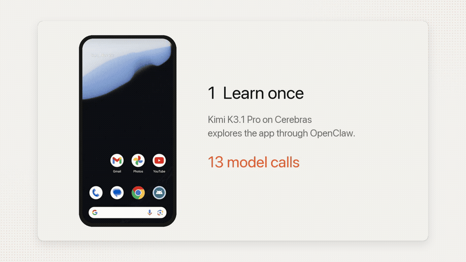
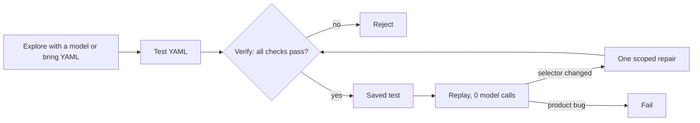

<h1 align="center"><picture><source media="(prefers-color-scheme: dark)" srcset="docs/brand/deja-logo-dark.svg"></picture></h1>

<p align="center">
Déjà is a verified memory layer for Maestro-compatible app tests across iOS, Android, and Web, with a native Rust runner in development. Learn a test once, then replay it with zero model calls.
</p>

<p align="center">
  <a href="LICENSE"></a>
  <a href="https://github.com/deja-run/deja/actions/workflows/rust-checks.yml"></a>
  <a href="https://github.com/deja-run/deja/actions/workflows/portable-checks.yml"></a>
</p>

<p align="center"></p>

<p align="center">All four steps, sped up 1.5x and silent. Full 55 s narrated walkthrough: <a href="demo/deja-demo.mp4">demo/deja-demo.mp4</a>.</p>

## Why Déjà

- **Zero model calls on replay:** Once verified, replays run without a model or API key.
- **Verified saves only:** A test is saved only after it passes its own clean verification run.
- **Honest failures:** A renamed selector gets one scoped repair (applying and verifying the patch on the supported Android policy, rolling back on failure), while a product regression stays failed.
- **Plain `maestro/v1` YAML:** Flows live in your repo as standard [Maestro](https://github.com/mobile-dev-inc/Maestro)-compatible YAML that your team reviews in pull requests.
- **Agent-ready:** Coding agents can replay your saved tests after each edit via `deja mcp` (`0` model calls).

## How it works

An AI model explores the app once and writes the test as YAML, or you bring existing Maestro YAML flows. Déjà runs the test cleanly on its own and saves it only if every assertion passes. Later runs replay the saved test with zero model calls. If a selector changes on a supported repair policy, Déjà applies a scoped two-file patch, rebuilds and verifies it (leaving the verified edit in place for review, or rolling back on failure); if a real product assertion fails, the run stays failed.



## Architecture & Rust migration

Today's runnable CLI uses the frozen TypeScript/Bun packages with a pinned Maestro runner (see Quick start below). Under [`rust/`](rust/Cargo.toml), Déjà is migrating toward a standalone **pure-Rust single binary** with planned native platform drivers (zero JVM, zero Maestro runtime dependency, targeting full `maestro/v1` YAML compatibility; currently at workspace scaffolding on `main`):

1. **iOS (Tier 1, planned):** `xcrun simctl` + minimal public-API Swift `DejaXCTestRunner` companion agent + `.ips` crash detection.
2. **Android (Tier 2, planned):** `adb` + bundled UiAutomator2 instrumentation APK (zero host JDK at runtime).
3. **Web (Tier 3, planned):** Direct Chromium Chrome DevTools Protocol (CDP) over WebSocket (zero Node/Playwright).

Déjà executes standard `maestro/v1` YAML flows and references the open-source [Maestro](https://github.com/mobile-dev-inc/Maestro) (Apache-2.0) specification and driver model for command and selector parity. Until the Rust binary reaches full cutover, use the TypeScript/Bun CLI below.

## Quick start (current TypeScript CLI)

These steps add Déjà to an iOS app on a simulator with no AI model required. You need a Mac with Xcode, Bun 1.4 or newer, and Java 17 or newer (Java and Bun will no longer be needed once the native Rust binary cuts over).

**1. Install the CLI and its pinned runner.**

```sh
git clone https://github.com/deja-run/deja.git ~/deja
cd ~/deja && bun install
# Run this line once. Use ~/.bashrc if your shell is bash.
echo 'alias deja="bun ~/deja/apps/cli/deja.ts"' >> ~/.zshrc
source ~/.zshrc

deja engine install
deja doctor
```

**2. Set up a dedicated simulator and build your app.** Run these from your app's repo root.

```sh
UDID=$(xcrun simctl create deja com.apple.CoreSimulator.SimDeviceType.iPhone-17)
xcrun simctl boot "$UDID" && xcrun simctl bootstatus "$UDID" -b

xcodebuild -project MyApp.xcodeproj -scheme MyApp -configuration Debug -sdk iphonesimulator \
  -derivedDataPath build CODE_SIGNING_ALLOWED=NO build
xcrun simctl install "$UDID" build/Build/Products/Debug-iphonesimulator/MyApp.app
echo "$UDID"
```

Use `-workspace MyApp.xcworkspace` instead of `-project` if your app uses a workspace. Reinstall after each new build.

**3. Add `deja.config.json` to your app's repo.** Put the simulator UDID from step 2 in `device`.

```json
{
  "workspaceRoot": ".",
  "platform": "ios",
  "appId": "com.example.myapp",
  "buildPath": "build/Build/Products/Debug-iphonesimulator/MyApp.app",
  "device": "YOUR-SIMULATOR-UDID",
  "fixtureCredentials": [],
  "manifest": "deja.walks.json",
  "flowsDir": ".maestro/flows/deja",
  "verificationTimeoutMs": 180000,
  "maestro": { "timeoutMs": 180000 }
}
```

Add `.deja/` and `build/` to `.gitignore`. `.deja/` holds local run history and reports.

**4. Write a test, or bring one you already have.** Tests are plain `maestro/v1` YAML, for example `.maestro/flows/deja/checkout.yaml`:

```yaml
appId: com.example.myapp
---
- launchApp
- tapOn: "Checkout"
- assertVisible: "Order placed"
```

**5. Save it.** Déjà runs the test on its own, saves it only if every check passes, and writes `deja.walks.json`. Commit `deja.walks.json` alongside your flows.

```sh
deja remember checkout --flow .maestro/flows/deja/checkout.yaml
```

**6. Replay it.** Expect `Cache status: hit` and `Model calls: 0`.

```sh
deja run checkout
```

On a new build, `deja run checkout --verify` re-verifies the test. To let a coding agent replay saved tests after each edit, run `deja mcp` ([MCP server](docs/REFERENCE.md#mcp-server)). Android and Chromium configs are in [docs/REFERENCE.md](docs/REFERENCE.md#configuration).

<details>
<summary>Run the iOS demo app</summary>

The iOS fixture app lives in `spikes/003-ios-deja` and requires step 1 above.

```sh
cd ~/deja/spikes/003-ios-deja
UDID=$(xcrun simctl create deja-demo com.apple.CoreSimulator.SimDeviceType.iPhone-17)
xcrun simctl boot "$UDID" && xcrun simctl bootstatus "$UDID" -b

xcodebuild -project DejaFixture.xcodeproj -scheme DejaFixture -configuration Debug \
  -sdk iphonesimulator -derivedDataPath build CODE_SIGNING_ALLOWED=NO build
xcrun simctl install "$UDID" build/Build/Products/Debug-iphonesimulator/DejaFixture.app
```

Replace `device` in `spikes/003-ios-deja/deja.config.json` with `$UDID`, then run:

```sh
deja remember checkout --flow flows/checkout.yaml
deja run checkout
```

</details>

<details>
<summary>Run the Android demo app</summary>

The Android fixture app lives in `spikes/001-android-deja`. It requires step 1, a running API 34 emulator, OpenJDK 21, and `adb`. `scripts/env.sh` sets `JAVA_HOME` and `ANDROID_HOME` assuming Homebrew under `/opt/homebrew` (adjust those variables if your JDK or Android SDK live elsewhere).

```sh
cd ~/deja/spikes/001-android-deja
. ./scripts/env.sh

adb devices
./gradlew clean :app:assembleDebug
adb -s emulator-5554 install -r -g app/build/outputs/apk/debug/app-debug.apk
sh scripts/fixture-mode.sh stable

# Verify reviewed YAML, then save it.
deja remember checkout --flow flows/repaired-checkout.yaml

# Replay it. Expect: Cache status: hit, Model calls: 0.
deja run checkout
```

</details>

## What works today

| Capability | Status |
| --- | --- |
| Verify and save existing `maestro/v1` YAML (`remember`, `deja.walks.json` v1 manifest) | iOS simulator, Android emulator, Chromium (beta, loopback URLs only) |
| Zero-model warm replay (`run`) + flaky rerun (`--rerun-failed`) + crash attribution | iOS simulator, Android emulator, Chromium (beta, loopback URLs only) |
| Release gate (`gate`) & static manifest check (`manifest check`) | iOS simulator, Android emulator, Chromium (beta, loopback URLs only) |
| Coding-agent MCP server (`deja mcp`) | Local stdio JSON-RPC |
| Build-bound validation history & failure classification (`selector`, `navigation`, `product_assertion`, `app_crash`, `timeout`, `runner`) | All three |
| Bounded selector repair & cold exploration (`explore`) | Android fixture (generalizing to iOS, Android, and Web in `rust/crates/deja-explore`) |

Full command options, config fields, and exit codes are in [docs/REFERENCE.md](docs/REFERENCE.md).

## Results

Measured runs recorded in `demo/live-evidence/`:

<p align="center"></p>

| Run | Evidence file | Outcome | Model calls | Assertions | Duration |
| --- | --- | --- | --- | --- | --- |
| Android cold explore | `android/cold-run-report.json` | cold-recorded | 13 | 14 | 97.9 s |
| Android warm replay | `android/warm-run-report.json` | passed (cache hit) | 0 | 14 | 26.1 s |
| Android stale selector repair | `android/stale-repair-run-report.json` | repaired (1 repair) | 0 | 12 | 66.9 s (repair step) |
| Chromium warm replay | `chromium/run-run-report.json` | passed (cache hit) | 0 | 12 | 36.6 s |

Warm replay eliminates model calls; execution time comes from the underlying device runner, which the native Rust drivers are designed to reduce further.

## CLI

| Command | What it does |
| --- | --- |
| `remember <goal> --flow <file>` | Verify your YAML and save it to the store (and write `deja.walks.json` when `manifest` is configured) only if every assertion passes. |
| `run <goal>` | Replay a saved test with zero model calls on a cache hit. On Android, a brand-new goal with no manifest entry or saved walk can invoke cold exploration (changed or unvalidated manifest entries never explore); on a stale selector with repair enabled, applies a scoped source patch, verifies it, and keeps the edit on pass (rolls back on failure). Supports `--verify`, `--rerun-failed`, `--junit`, `--summary`. |
| `gate --goals <file>` | Check that every required goal passed on the current build and write release-gate evidence. |
| `manifest check` | Statically verify flow closures and assertion hashes against `deja.walks.json` without a device. |
| `list` | List saved walks. |
| `inspect <report>` | Print a saved, redacted run report. |
| `explore <goal>` | Cold-explore an app with an OpenAI-compatible model, verify the resulting YAML, and save if it passes. |
| `mcp` | Start the local stdio MCP server for coding agents. |

## Bring your own model

Only cold exploration (`explore`, or `run` on Android for a brand-new goal with no manifest entry or saved walk; changed or unvalidated manifest entries never explore) calls a model. Remembering, replaying cache hits, gating, and static manifest checks never require a model or API key. In the current TypeScript CLI, exploration runs through OpenClaw and requires an `https://` OpenAI-compatible chat endpoint that supports tool calls; see [docs/REFERENCE.md](docs/REFERENCE.md#bring-your-own-model) for configuration details.

## Roadmap

Core open-source product (in active development under [`rust/`](rust/Cargo.toml)):

- **Pure-Rust core & SQLite v5 store (`deja-core`, `deja-store`):** 100% `deja.walks.json` v1 hash parity, streaming build fingerprinting, multi-build/multi-runtime history, durable flaky tracking, and multi-store sharded release gates.
- **Native `maestro/v1` interpreter (`deja-flow`):** Full `maestro/v1` YAML execution, selectors, structured failure classification, JUnit XML, JS scripting (`evalScript`/`runScript`/`assertTrue`), clipboard, random inputs, and `config.yaml`/tag filtering.
- **Native platform drivers (iOS -> Android -> Web):**
  - iOS (`deja-driver-ios` + `DejaXCTestRunner` Swift companion)
  - Android (`deja-driver-android` + bundled UiAutomator2 APK, zero host JDK)
  - Web (`deja-driver-web` via direct Chromium CDP, zero Playwright/Node)
- **Single native CLI & MCP binary (`deja-cli`, `deja-mcp`):** Multi-goal batching, dynamic `--devices` sharding, `SIGINT`/`SIGTERM`/`$/cancelRequest` cancellation, and standalone `darwin-arm64` / `linux-x64` release binaries.
- **Cross-platform graph explorer & path memory (`deja-explore`):** Cold exploration, reusable subflow composition, and bounded selector repair proposals across iOS, Android, and Web.

## Contributing

Pull requests from outside contributors are not accepted right now. Bug reports and ideas are welcome as [GitHub issues](https://github.com/deja-run/deja/issues). See [CONTRIBUTING.md](CONTRIBUTING.md).

## License

[Apache-2.0](LICENSE)

The Déjà name is covered by the [trademark policy](TRADEMARKS.md) (draft).
