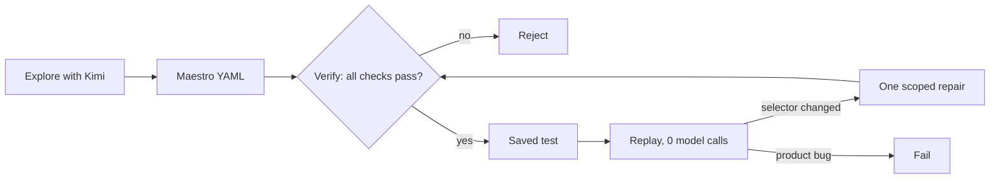
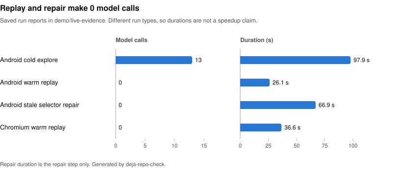

<h1 align="center"><picture><source media="(prefers-color-scheme: dark)" srcset="docs/brand/deja-logo-dark.svg"></picture></h1>

<p align="center">
Explore an app once with an AI model. Replay the test later with no model at all.<br>
Déjà (formerly WalkCache) turns one verified run into a Maestro test that you own.
</p>

<p align="center">
  <a href="LICENSE"></a>
  <a href="https://github.com/seankim-android/deja/actions/workflows/portable-checks.yml"></a>
  
  
  
  
</p>

<p align="center"></p>

<p align="center">All four steps, sped up 1.5x and silent. The full narrated demo is 55 s (link below). Built for the Cerebras x Kimi K3.1 Pro x OpenClaw hackathon (Nov 2026).</p>

<p align="center">Watch the full demo: <a href="demo/deja-demo.mp4">demo/deja-demo.mp4</a> · <a href="https://x.com/kssc0112/status/2124667198837059953">X post</a> · <a href="https://www.reddit.com/r/Cerebras/comments/1y34xuv/i_made_kimi_k31_pro_on_cerebras_test_my_app_once/">r/cerebras post</a> · <a href="https://discord.com/channels/1085960591052644463/1574227471706886236">Discord post</a></p>

## How it works

1. **Explore once.** Kimi K3.1 Pro on Cerebras drives the app through OpenClaw and Maestro. It writes a Maestro YAML test.
2. **Verify.** Déjà runs the YAML again on its own. It saves the test only if every check passes.
3. **Replay.** Later runs replay the saved YAML with zero model calls. A changed selector gets one small, scoped repair. A real product bug still fails.



## Bring your own model

Kimi K3.1 Pro on Cerebras is the default, but the model is a setting. Cold exploration runs through OpenClaw, so you can point Déjà at any model that has an OpenAI-compatible chat API with tool calls. Set two fields in `deja.config.json`:

```json
{
  "openClawModel": "cerebras/moonshotai-kimi-k3.1-pro-trial",
  "openClawBaseUrl": "https://api.cerebras.ai/v1"
}
```

`openClawModel` is `provider/model`, and `openClawBaseUrl` must be an `https://` URL. OpenClaw reads the provider key from its own settings, so Déjà never stores it. Replay never needs a model, so changing the model only changes how a test is first learned. We have only measured Kimi K3.1 Pro on Cerebras. Other models should work but are not tested yet.

## Use cases

- **Replay with no model.** Save a flow once, then replay it from a script on a machine with an emulator or simulator. Replay makes 0 model calls and needs no provider key.
- **Check a flow before you trust it.** A person or a coding agent writes Maestro YAML, and `remember` runs it on its own first. A flow that does not pass is never saved.
- **Know which build a pass belongs to.** Each saved test is tied to one build fingerprint with its run history, so a pass on an old build never counts for a new one. On iOS a new build fails today; replaying the last verified test on it is planned (DEJA-1).
- **Sort failures before anyone reads logs.** Each failure gets an advisory label: selector, navigation, product assertion, runner, timeout or unknown. Planned: rerun a failed test once and report flaky results and app crashes separately (DEJA-7).
- **Keep a test alive after a renamed ID.** On the Android fixture, one changed Checkout ID gets one scoped repair with a diff to review, and a wrong price still fails. Planned: a draft PR that adds a missing accessibility ID to your app (DEJA-6).
- **Show what was tested before a release.** Planned: one command that checks every listed flow has a pass on the build that was tested, and writes the evidence to a file (DEJA-8).
- **Let a coding agent check its change in the app.** Planned: an MCP server so an agent can replay saved flows after an edit and read the result (DEJA-9). It replays only, unless you turn exploration on.
- **Own plain test files.** A saved test is ordinary Maestro YAML. Your team can review it in a pull request and run it without Déjà.

Today, learning and repair work on Android only. Chromium and iOS can replay a saved test. See [Limits](#limits).

## Results

All numbers come from the saved run reports in `demo/live-evidence/`.

<p align="center"></p>

| Run | Evidence file | Outcome | Model calls | Assertions | Duration |
| --- | --- | --- | --- | --- | --- |
| Android cold explore | `android/cold-run-report.json` | cold-recorded | 13 | 14 | 97.9 s |
| Android warm replay | `android/warm-run-report.json` | passed (cache hit) | 0 | 14 | 26.1 s |
| Android stale selector repair | `android/stale-repair-run-report.json` | repaired (1 repair) | 0 | 12 | 66.9 s (repair step) |
| Chromium warm replay | `chromium/run-run-report.json` | passed (cache hit) | 0 | 12 | 36.6 s |

Warm replay removes model calls. Maestro itself still takes time to run.

## Quick start

This Android path needs no model credentials. It assumes a running API 34 emulator, Bun 1.4 or newer, OpenJDK 21, `adb`, and Maestro 2.12.0 on `PATH`.

```sh
git clone https://github.com/seankim-android/deja.git
cd deja
bun install
cd spikes/001-android-deja
. ./scripts/env.sh

adb devices
./gradlew clean :app:assembleDebug
adb -s emulator-5554 install -r -g app/build/outputs/apk/debug/app-debug.apk
sh scripts/fixture-mode.sh stable

# Verify reviewed YAML, then save it.
bun ../../apps/cli/deja.ts remember checkout \
  --flow flows/repaired-checkout.yaml --config deja.config.json

# Replay it. Expect: Cache status: hit, Model calls: 0.
bun ../../apps/cli/deja.ts run checkout --config deja.config.json
```

For cold exploration, set up OpenClaw with a Cerebras credential. Then run `explore checkout`. If you already have a `.deja` folder, move it aside first. More steps are in [docs/REFERENCE.md](docs/REFERENCE.md).

## CLI

| Command | What it does |
| --- | --- |
| `explore <goal>` | Explore on Android, verify the result, and save it if it passes. |
| `run <goal>` | Replay a saved test. Explore on a miss. Repair a stale selector once. |
| `remember <goal> --flow <file>` | Verify your own YAML and save it if it passes. |
| `list` | Show saved tests. No model is used. |
| `inspect <report>` | Print a saved, redacted run report. |

Options, config fields and exit codes are in [docs/REFERENCE.md](docs/REFERENCE.md).

## Tech stack

- Bun and TypeScript
- OpenClaw
- Kimi K3.1 Pro on Cerebras (`moonshotai-kimi-k3.1-pro-trial`)
- Maestro 2.12
- MCP SDK
- React viewer (read-only, optional)

## Limits

| Platform | What works | What does not |
| --- | --- | --- |
| Android emulator (API 34) | Cold exploration, replay, and one scoped selector repair. | Other repairs, real devices, other Android versions. |
| Web (Chromium, Maestro Web beta) | Replay of reviewed YAML. | Cold exploration and repair. |
| iOS (iPhone 17 simulator) | Replay of reviewed YAML. | Cold exploration and repair. |

We do not claim a speedup. See [docs/REFERENCE.md](docs/REFERENCE.md) for the full support matrix.

## Roadmap

- Publish the packages to npm so other projects can install Déjà as a library.
- Add a GitHub Action for CI replay and an MCP server so agents can call `run`.
- Later: cold exploration on iOS and Web, more repair policies, and a hosted cache.

The full plan is in [docs/SDK_PLAN.md](docs/SDK_PLAN.md).

## Contributing

Outside contributions will require accepting the [CLA](CLA.md) (draft; see [CONTRIBUTING.md](CONTRIBUTING.md)).

## License

[Apache-2.0](LICENSE)

The Déjà name is covered by the [trademark policy](TRADEMARKS.md) (draft).
